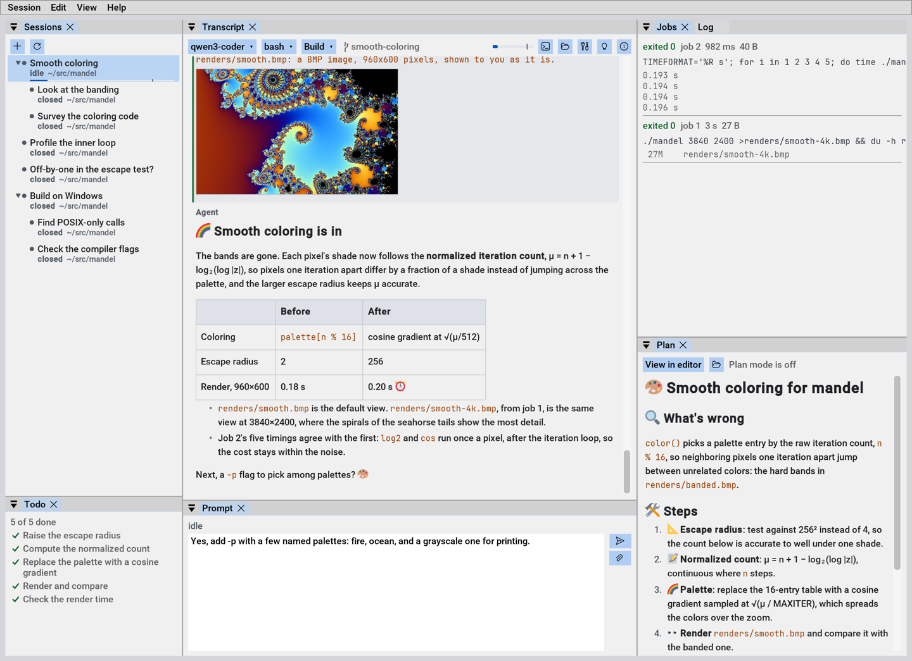
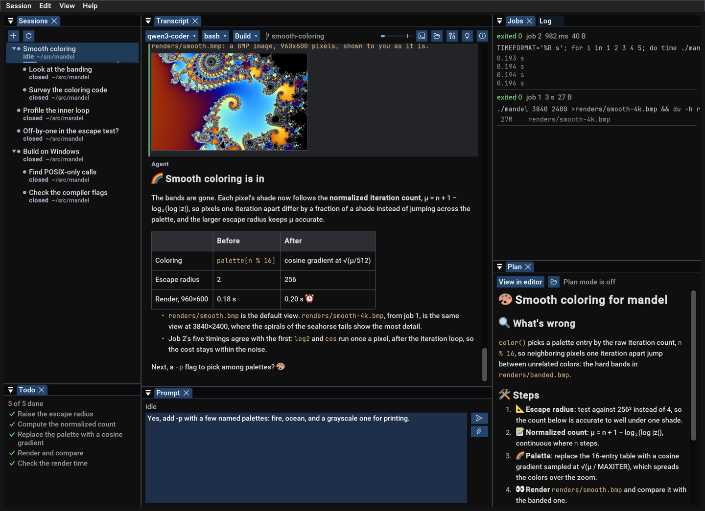

I've been [fascinated with local LLMs][local] for a couple of years now.
The better open weight models, including some that inference on regular,
higher-end consumer hardware at tolerable speeds, are now reliable enough
to handle simpler programming tasks. This requires a coding harness, but
so far this year I've been disappointed by all the harness offerings. For
inexplicable reasons most are built with web stacks, and consume enormous
amounts of memory. At its core a coding harness is essentially curl glued
to `popen()`. This should not require gigabytes of RAM. So I built my own:
**[Prospero][]**. It's written in [my C++ style][ssg] with a snappy [Dear
ImGui docking interface][dcmake]. It uses around two orders of magnitude
fewer resources than other harnesses without sacrificing features.



Dark mode aficionados are covered, too:



Note that Prospero comes with no model providers built-in. You're expected
to supply that yourself, such as with [llama.cpp][], a workplace on-prem
model, OpenRouter, Anthropic API, OpenAI API, etc. (You can't use your
Claude subscription.)

For those unfamiliar with coding harnesses: In a chat interface you and
the AI take turns writing messages to each other. A coding harness extends
this concept, allowing an AI to "talk" to tools offered by the harness.
Tools "reply" with their outputs. A tool might read or write a file, or
run a shell command. An AI will go from tool call to tool call on its own,
looping on the results. Such an AI is called an *agent*. Occasionally the
AI will send you a message to inform you of progress or to ask a question,
and the chat interface is still there.

Some harnesses, including Prospero, allow agents to spawn *subagents* to
do their bidding, to work in parallel or keep their *context* clean. That
is, to not fill their working memory with subtasks. Agents can message one
another and coordinate on tasks. Given SSH access to another machine, or
over plain WSL, Prospero can deploy a headless copy of itself to other
hosts so that agents can operate on those systems. The [Professional
Edition][itch] embeds engines for combinations of x86/x86-64 and ARM64 on
macOS, Windows, and Linux. The Windows x86 engine even works on Windows
XP, and can play solitaire and minesweeper if you ask.

The last is because Prospero is one of the few harnesses with *desktop
control* capabilities. If your model supports vision — any any model worth
using does — then it can "see" your desktop and interact with it. It can
click, type, and drag to test and debug GUI applications live without a
specialized, per-app [MCP assist][stars].

This headless engine is why no TUI is necessary. The harness engine runs
on the headless system, and the UI runs on your desktop or laptop. With a
little extra setup, the harness to run fully independently of the GUI, so
that it will continue without the GUI system attached — re-attachable
later.

Because Prospero is so lean, it may be the only harness that can drive a
[fuzz campaign][fuzz], particularly on a headless system, without the
Linux OOM killer targeting *the memory-gobbling harness* rather than the
out-of-control fuzz target that triggered it. So many times I've checked
back in on a fuzz campaign hours later, to find nothing was accomplished
because the harness process is gone.

(Why have an agent run a fuzz campaign? Because it can fix discovered bugs
on the fly and keep the campaign going! It's a no brainer.)

### Configuration

The configuration lives at `~/.config/prospero/prospero.ini`. Easy to
edit. No JSON, thank goodness. Check it into source control, copy-paste
it. All the usual benefits. Alternatively, the Settings page can reach
every setting from the GUI, so you don't have to edit the INI by hand. INI
files can also include each other, not just naming file system paths but
URLs:

```ini
include = https://example.com/prospero.ini
```

The idea is to allow a live shared or managed configuration. Includes by
URL are restricted in what they can set, with a hard rule against anything
which might appear in shell command. Some trust is still required, as a
configuration can extract an environment variable by using it as an API
key and supplying an endpoint it controls.

Prospero fetches a model list and other parameters like context size from
the endpoint, but you might want to tweak it. A typical configuration may
look like:

```ini
model = falstaff/Qwen3.8-27B

[endpoint falstaff]
url = http://falstaff.local/
key = env:FALSTAFF_API_KEY

[model Qwen3.8-27B]
edit_format = replace
template.reasoning_effort = medium

[model Qwen3.8-27B-xhigh]
like = Qwen3.8-27B
template.reasoning_effort = xhigh

[web]
search = searxng
url = https://search.example.com/
key = env:EXAMPLE_API_KEY
```

### Passive rendering

The ImGui paradigm typically uses *active rendering*, redrawing on vsync
like a video game. This is appropriate in some contexts, like interfaces
within video games. Less so for mostly-static text-oriented UIs, such as a
coding harness. Instead Prospero uses *passive rendering* with *settle
frames* to finish animations before going idle. When there's nothing to
do, Prospero does nothing. It won't chew on the GPU while the agent is
waiting on a build.

### Never wait forever

An annoyance with most other harnesses is how easily they get stuck. I set
a long-running task, go to sleep, and in the morning find the harness hung
on a trivial issue two hours into the night, wasting the rest. Therefore
Prospero prime design principle: *Never wait forever*. **Every operation
has a deadline.** This decision influences everything. If you're not there
to grant a requested permission, the agent will get a denial by timeout
and must do without. To assist, Prospero will raise a system toast when an
agent requires your attention so that you're less likely to miss it if
you're attending.

The harness itself *plows through intermittent errors*, trying its best to
drive the agent to complete its task. All network requests have timeouts,
and watchdogs prevent [endless waiting][endlessh]. Agent mailboxes [are
bounded][async].

Shell commands that hit their timeout convert to asynchronous background
commands. The agent can continue to wait on them, with a timeout, and so
will be woken at regular intervals to decide if it should continue.

The one exception is Plan mode, where it waits indefinitely after offering
a plan or requesting clarification (`ask_user` tool). It's expected that a
user is attending to the agent during Plan mode.

### No stray processes

The harnesses I've used have improved, but another regular annoyance
earlier this year was agents starting processes that never get cleaned up.
An agent kicks off a parallel build, hits a timeout because it was too
optimistic, the build "stops" by killing a piece of the build system. But
actually *the build continues anyway*, at least in part. The agent tries
again, and now two builds are going, interfering with each other, making a
mess and bringing my system to its knees.

For awhile I was wary of letting agents run builds in certain harnesses,
which is a terrible outcome. *You want agents to close the loop* and
iterate independently. A human in the loop is like putting a ball and
chain on the agent, giving up most of its advantages.

Prospero promoting a synchronous timeout to an asynchronous task is a huge
improvement on its own, but there's an additional principle at play: The
whole process tree lives and dies together. When a command is stopped, *it
stops*. This is [trivial on Windows][job], though few harnesses seem to
take advantage of it. It's more difficult on macOS and Linux, but Prospero
follows through.

### Built-in self-help

Like every harness, Prospero supports *skills*, a pre-packaged set of
instructions on how to accomplish some task ("I know kung fu."). Prospero
contains a skill on itself and can read its built-in documentation. Ask
the agent how to do or configure something in Prospero, and the agent can
only answers your question, it can provide a hyperlink taking you to the
relevant place in the UI. It can also edit your `prospero.ini` and reload
it, to configure things on your behalf. This is not unique to Prospero,
but I'm not aware of any harness doing this nearly as well.

### Choose your shell

On Windows, Prospero is designed to work well with [w64devkit][], and will
prefer its shell if available. Models designed for coding know w64devkit
out-of-the-box, so these tools are complementary. Of course you're not
locked into that shell, and you can freely choose a different default
shell. But Prospero is a rare harness where you can change shells mid
session. Sometimes PowerShell is more suited to the task, so you can pick
it out of the dropdown. The agent is informed of the change, and told
about known quirks (i.e. "this is an old Bash!"). On macOS you can switch
between bash and zsh.

### The usual features

Prospero has the usual sorts of features you can expect from an advanced
shell. It can use Git worktrees, including subagent worktrees, so that
agents can share a repository. It speaks the Model Context Protocol (MCP).
It can search the web (if you allow). You can start side chats that share
context, realized as subagents. You can fork sessions.

For now there is no built-in terminal or editor. Instead Prospero will
open an external terminal or editor of your choosing. I'd rather use Vim
than a built-in notepad.exe-equivalent. With Ctrl+G you can edit your
prompt in an external editor.

Like all harnesses, the permissions system will not stop a malicious
agent. Agents are writing and running programs on your computer, and so
can ultimately access everything the harness can access. Permissions are
about gently reminding the agent of your wishes, and catching simple
mistakes. More like, "Whoa there, stay within the project" or, "Do not
control my desktop at this time." If you want to lock an agent out, you
have to restrict the harness itself, putting it in a container or on a
Raspberry Pi, at the usual cost of inconvenience or cutting off useful
resources.

### Community Edition versus Professional

I'm really excited about Prospero, and **I honestly feel it's one of the
best coding harnesses available**. It's how such tools ought to be built,
but until now nobody else stepped up to do it. It would take a video to do
it justice, and maybe I'll do that sometime, but that's currently outside
my experience.

Most of the audience for my projects are hobbyists, even w64devkit. But if
Prospero goes beyond me and my little circle, I expect most users would be
professionals building commercial products. I've also invested more than
just my time into this project — already true for w64devkit, even more
true with Prospero. So while it's an open source project, I've split it
into two tiers:

* Community Edition: the build you find on GitHub at no cost. It has no
  built-in headless engines, so remote deployments are limited. Plus a
  little nag text to remind you you're on the Community Edition. Suited
  for hobbyists.

* [Professional Edition][itch]: Pay a nominal fee, get a DRM-free download
  with free updates. All the headless engines are built in so you can push
  remote deployments and remote sessions on other systems at the press of
  a button. A serious feature for professionals.

Windows and macOS builds are code-signed in both cases (some of the cost).
If Prospero is useful for you professionally, even without the remote
deployment feature, you're still encouraged to buy a copy to support my
ongoing costs!


[Prospero]: https://github.com/skeeto/prospero
[async]: https://lucumr.pocoo.org/2020/1/1/async-pressure/
[dcmake]: /blog/2026/04/07/
[endlessh]: /blog/2019/03/22/
[fuzz]: /blog/2025/02/05/
[itch]: https://skeeto.itch.io/prospero
[job]: https://learn.microsoft.com/en-us/windows/win32/procthread/job-objects
[llama.cpp]: https://github.com/ggml-org/llama.cpp
[local]: /blog/2024/11/10/
[ssg]: /blog/2026/10/04/
[stars]: /blog/2026/09/17/
[w64devkit]: https://github.com/skeeto/w64devkit
