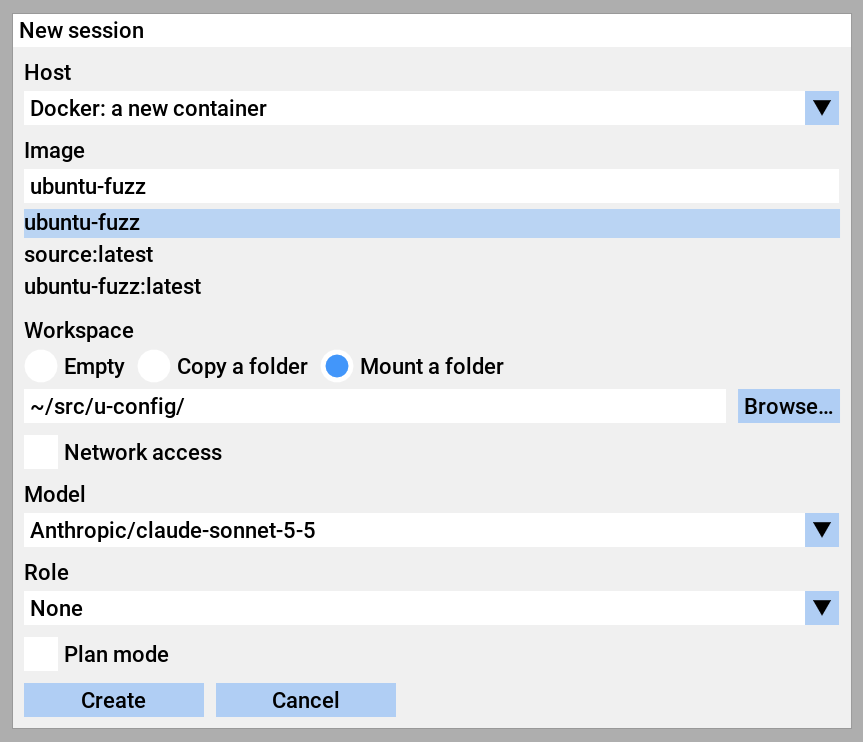
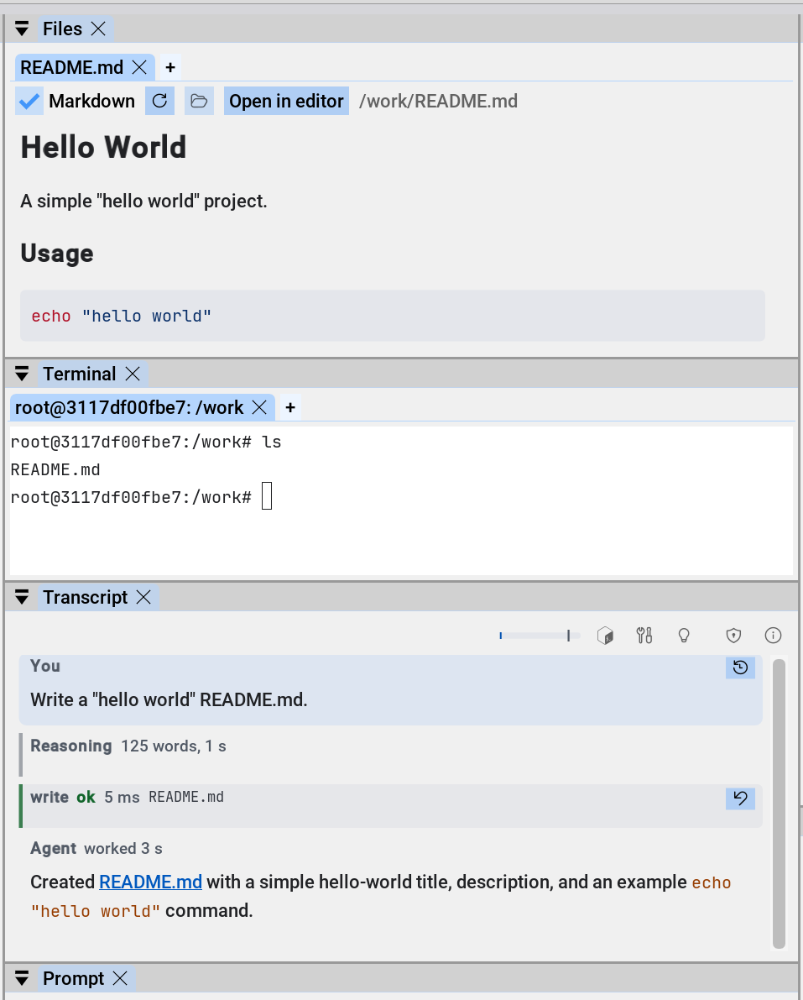

Fuzz testing remains an effective tool for discovering software defects,
more so than ever with AI agents driving, fixing bugs on the fly, clearing
the way for deeper fuzzing, all unattended. My [coding harness][intro],
[Prospero][], is particularly suited for this task via its unique *deploy
to container* feature. With a bit of one-time prep work, you can run
agents within a no-network Docker or Podman container with instructions to
set up and run a fuzzing campaign on your repository. Any fallout from the
agent or fuzzing campaign is safely trapped in the container, while bug
fixes flow out freely. As far as I'm aware, Prospero is the only AI
tooling with this capability.

Fuzz testing has always risked its host. The whole point is to drive the
target into undefined behavior, which may summon nasal demons. Coding
agents are a new risk to hosts. While not malicious in practice, they make
mistakes like humans and may accidentally destroy or leak data to which
they have access. Harness sandboxing and permissions systems are merely
tools to communicate intention and catch simple mistakes. They cannot
contain an agent with the ability to run arbitrary code as part of its
job. Assume an agent can do anything its coding harness can do.

That's where Prospero comes to the rescue. When you create a new session
you can select "new container" as the host, an image, whether to enable
networking, and the contents of the workspace. Give the agent a copy of
your repository or mount it inside the container. I recommend the latter
because the agent can commit fixes directly, and you won't have to get
fixes out of the container somehow. Though of course the agent can change
or delete anything in the repository, so give it its own clone (not a
worktree) if that's an issue. Without networking the agent cannot push or
pull, but you can.



Prospero creates a container running a headless harness, precompiled for
Linux for this very purpose. **Only [Professional Edition][] comes with
these headless engines — 40% off Black Friday Sale through December 2nd**.
So *the harness itself is constrained to the container*. The GUI connects
by pipe to this harness and presents it as a normal, local session. It
relays AI chat completions for the container, which is how it operates
without a network. If you grant permission when asked, it also relays
`web_search` and `web_fetch` requests. So this no-network agent has
narrow, restricted internet access in case that's useful, such as to
search information or download a dependency. Close the GUI and the
container harness continues independently until it needs the relay, where
it pauses and waits.

If the agent needs more from you, and you used a mounted workspace, then
you can move or copy the file to that directory on the host and the agent
will get it. Mounts make getting data in and out easier.

The Terminal pane is fully functional. If you open a terminal
(<kbd>ctrl+`</kbd>) you'll get a shell inside the container, such as to
poke around or assist the agent. The Files pane is also 100% functional,
even including "Open in editor" if it's a mounted container, so you can
examine text files and pictures within the container in Prospero.



If you have questions about the details, ask your agent while mentioning
Prospero. It will load the built-in help skill and link the appropriate
Help pages when it answers.

### Create the image

As mentioned you'll need an image, and so the one-time prep work is to
create an image with the basic tools an agent might need: compilers,
fuzzers, debugging tools, build tools, dependencies, etc. You might even
include terminal tools for yourself, like Vim. Here's a minimal Dockerfile
for C and C++ with libFuzzer and AFL++:

```dockerfile
FROM ubuntu:26.04

RUN apt-get update \
 && apt-get install -y --no-install-recommends \
        build-essential \
        gcc-15-plugin-dev \
        clang \
        libclang-rt-dev \
        lld \
        cmake \
        ninja-build \
        pkg-config \
        autoconf \
        automake \
        libtool \
        git \
        python3 \
        gdb \
        xxd \
        procps

WORKDIR /afl
ARG AFL_VERSION=5.03c
ADD --checksum=sha256:07f089e8591209862898c770a569d8e2b74b459fe967db323fc6a3924dcc82b5 \
    https://github.com/AFLplusplus/AFLplusplus/archive/refs/tags/v${AFL_VERSION}.tar.gz ./
RUN tar xzf v${AFL_VERSION}.tar.gz \
 && cd AFLplusplus-${AFL_VERSION} \
 && make -j"$(nproc)" \
 && make install

WORKDIR /work
ENV AFL_QUIET=1 \
    AFL_SKIP_CPUFREQ=1 \
    AFL_I_DONT_CARE_ABOUT_MISSING_CRASHES=1 \
    UBSAN_OPTIONS=handle_sigtrap=1 \
    ASAN_OPTIONS=handle_sigtrap=1 \
    ASAN_OPTIONS=detect_stack_use_after_return=1:max_malloc_fill_size=1073741824
CMD ["/bin/bash"]
```

With that saved as `Dockerfile`:

    $ docker build -t ubuntu-fuzz .

No Linux distribution has shipped a working AFL++ for some years now, so
it's compiled from source. The main value is you can fuzz with both GCC
and Clang, which produce slightly different instrumentation and catch
different defects. I also [set sanitizer configuration as advice for the
agent][tips].

Alternatively, explain your situation to an agent, perhaps the same model
you'll use for fuzzing, and have it set up the image for you.

### Prompt for fuzzing

Once you have your image, and you've created your mounted workspace
session, then you tell the agent what you want. The prompt can be this
simple:

> Add libFuzzer and AFL++ tests to this project. Then run a fuzzing
> campaign under ASan, UBSan, `-D_FORTIFY_SOURCE`, and `-D_GLIBCXX_DEBUG`.
> Fix and commit findings as they are discovered.

Consider Plan mode depending on project size. Set it on a long campaign
before you go to sleep, and you might have interesting results in the form
of fix commits when you wake up. The container harness has access to the
skills on your host — again, by relay — so if you do this often you might
want to put it in a skill, further streamlining the whole process.

In general, mid-tier models are fine as fuzz campaign drivers, and even
models below those usually work well, including local models. Writing fuzz
tests and fixing the resulting bugs (off-by-one, etc.) doesn't take much.
The main issue you'll have is refusals. Far too many models are trained to
treat fuzz testing as a specialized offensive tool, where in reality it's
just basic testing, regularly used by anyone taking software development
seriously.

If your own projects aren't suitable, try an open source project that
hasn't seen much fuzz testing. The containment makes it low risk, and
fixes that pop out tend to be simple and easy to send back. If you're only
looking to see it in action, try it on [the GNU Recutils source][ftp]. The
latest release (1.9) is packed with low-hanging fruit, and in minutes
you'll produce a dozen commits fixing buffer overflows and such.


[Professional Edition]: https://skeeto.itch.io/prospero
[Prospero]: https://github.com/skeeto/prospero
[ftp]: https://ftp.gnu.org/gnu/recutils/
[intro]: /blog/2026/10/31/
[tips]: /blog/2025/02/05/
